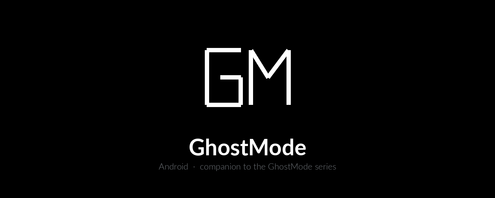

<p align="center">
  
</p>

<p align="center">
  
  
  
  
</p>

# GhostMode Android

**A personal review-and-clean app for the phone you own.**

This is the Android companion to [GhostMode](https://github.com/cmpsec/ghostmode), the Linux privacy toolkit. The Linux project works on the computer. This one works on the handset: what was installed today, what was used, what is hidden on storage, which accounts are signed in, what Chrome has open, and the call and message logs. You pick a day, look, and clear what you want gone.

The interface is black and white. The mark is the two letters **GM**.

It is for the owner of the device. It does not reach other people's phones.

---

## Who this is for

Anyone who wants a single screen for their own Android phone: what landed on it, what they opened, and what they would rather not leave behind. It sits next to the Linux GhostMode tools, for the same person, on the other device they carry.

It is **not** a way to enter, watch, or wipe someone else's phone. Every screen it opens is on the device where the app is installed, and the last word on removing an account stays with the person holding that phone.

---

## What you can do

The day you pick at the top applies only to **installed apps** and **apps used that day**. Everything else is the full list, not a slice of that day.

| Section | What it shows | What clear does |
| --- | --- | --- |
| Apps | Packages installed on the selected day | Uninstall |
| Files | Today's files, plus every hidden file and folder on shared storage, of any date. Photos and videos show a small frame | Delete the selected items |
| Accounts | Accounts on the device, including mail and app accounts | Opens system Settings, then Users & accounts, then that account, and presses Remove account. You confirm the last step |
| Calls | The call log | Delete the selected entries |
| Chrome | History titles and addresses, read from Chrome's own History screen | Wipes Chrome's data: history, passwords, cookies, and site data |
| Usage | Apps that were in the foreground on the selected day | Clear storage for that app |
| Clipboard | One action, not a list | Clears the clipboard, then writes the word Copy |

Hidden files stay in the file list no matter which day is selected. Account, Chrome, clipboard, call, and message actions are never limited to that day.

---

## How the powerful actions actually run

Some of this cannot be done by an ordinary sideloaded app on its own. GhostMode says so in the app, and it asks for the extra step instead of pretending device admin is enough.

- **Shizuku** (or a root shell) runs the shell commands: clear storage, wipe Chrome, list accounts the app itself is not allowed to see, and lift the "Restricted settings" block so the accessibility service can be turned on.
- **Accessibility**, named GhostMode, reads the History page inside Chrome, and walks Settings → Users & accounts → the account you selected so Remove account can be pressed. It stops on the confirmation. You tap Remove.
- **Default SMS app**, only while a delete is in progress. Android lets only the default messaging app delete messages. GhostMode asks for that role, deletes, and you can switch the previous app back under Default apps.
- **Device admin** is a separate switch. It does not list accounts, clear storage, read Chrome, or delete messages.

The in-app **Setup guide** walks through developer options, wireless debugging, pairing Shizuku, the Shell chip, and the restricted-settings path for a sideloaded app.

---

## Honest limits

- Chrome's history database is private. Without root, the list comes from the History screen, so the accessibility service has to be on and Chrome has to stay in front while it is read.
- A Google account cannot be deleted silently by this app. The system confirmation is required.
- Clear storage and the Chrome wipe need Shizuku running, or root. After a reboot, Shizuku has to be started again.
- On Android 13 and newer, a sideloaded app may show **Restricted settings** until that block is allowed for GhostMode.
- The build published here is the debug package, version **1.10**. The install name is GhostMode. The package id stays `com.today.td` so an update replaces the copy already on the phone.

---

## In this repository

The installable app sits beside the source:

```
GhostMode.apk          the app, version 1.10
app/                   Android source
build.sh               debug build
assets/                banner and GM mark
```

Install `GhostMode.apk` over the previous copy. Open the setup guide on first launch if you want Shizuku and the accessibility service.

---

## Build

The script expects a local Android SDK and JDK 17 laid out the way this project builds today (`JAVA_HOME` and `ANDROID_HOME` under the sibling `.android-build` directory). From this folder:

```bash
./build.sh
```

The new package is written to `app/build/outputs/apk/debug/app-debug.apk`.

---

## Series

- [GhostMode](https://github.com/cmpsec/ghostmode) — the Linux toolkit: Tor and a kill switch, fingerprint rotation, location, metadata, and cleanup
- GhostMode Android — this repository

---

## License

[MIT](LICENSE)
